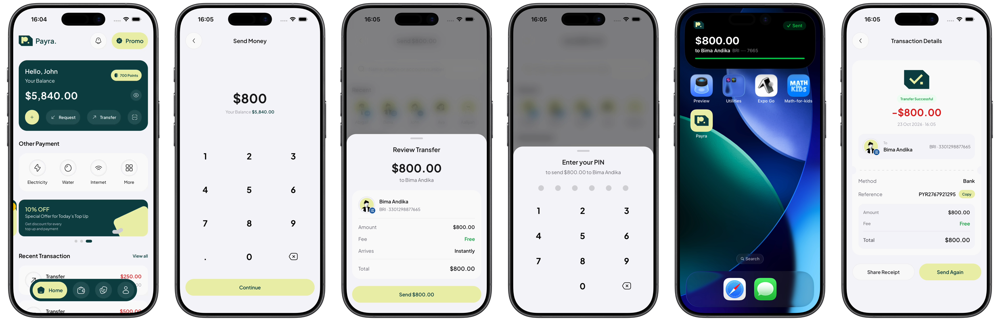

# Payra

A light, calm e-wallet app for iOS, built from a Figma design with Expo and React Native. Unlock with your PIN, check your balance, send money to a person or a bank account, confirm it in a sheet, follow the payment in the Dynamic Island and share the receipt — one complete flow of the design, with motion that feels native.



**▶ [Watch the 42-second walkthrough](docs/demo.mp4)** (recorded on iPhone)

Expo SDK 57 · React Native 0.86 · React 19 + React Compiler · Expo Router · Reanimated 4 · Unistyles 3 · [@okoli/ui](https://github.com/okoliken/okoli-ui) · Zustand · TypeScript

---

## What's in it

| Flow | Screens |
| --- | --- |
| Start | Launch, three-slide onboarding, unlock with a 6-digit PIN (any PIN works) and a loading hold |
| Home | Balance with hide/reveal, quick actions, offers carousel, recent transactions |
| Send | Amount keypad with a balance check → "Send to" (name, phone or account number; bank lookup) → Review and PIN in one sheet → processing → result |
| After | Transaction detail with a receipt you can share as an image; the payment's Live Activity in the Dynamic Island and on the lock screen |
| Tabs | Wallet (swipeable card stack), History (search, filter, grouped by day), Profile |

Data is local (`src/data/mock.ts`) and app state is a Zustand store persisted to AsyncStorage, so the app runs with no backend and balance and history survive relaunches.

## Things worth looking at

**Shared UI kit**
- The generic pieces — `Button`, `Tappable`, `Sheet`, `Keypad`, `PinPad`, `SearchBar`, `PrivacyShield`, `Text` and the motion presets — come from [@okoli/ui](https://github.com/okoliken/okoli-ui), my own React Native kit. Payra keeps thin wrappers only for its Figma details (114pt keys, the Solar icons, the logo on the privacy cover).
- `src/theme/tokens.ts` maps the Figma style guide onto the kit's theme contract, so the kit's components render in Payra's colours, type and radii.

**Motion on the UI thread**
- Hiding the balance fades the amount up while six dots fade in one after another; one shared value drives every piece (`src/app/(tabs)/index.tsx`).
- The wallet's card stack keeps two persistent slots whose positions live entirely in shared values, so a swipe never waits on a React re-render (`src/components/card-stack.tsx`).
- The tab bar's active chip grows from a circle to its labelled width while its colour and label fade in (`src/components/tab-bar.tsx`).
- Review and PIN share one sheet that eases its height between steps and keeps its content frozen while it slides out, so nothing visibly resets (`src/components/review-sheet.tsx`).
- The receipt draws its check, counts the amount up and fades its rows in one after another (`src/app/transaction/[id].tsx`).

**Banking-app details**
- A privacy cover blurs the app the moment it goes inactive, so balances never appear in the app-switcher snapshot — including inside sheets, which are separate windows.
- Going over your balance turns the amount red, shakes it with an error haptic and says why (`src/app/send.tsx`).
- Typing digits into "Send to" turns it into an account transfer: suggested banks fade in, then the holder's name is looked up (`src/app/send-to.tsx`).
- Every person has a DiceBear portrait seeded by their name, so they look the same on every screen (`src/components/person-avatar.tsx`).

**Native iOS pieces**
- `modules/payra-activity` is a local Expo module that starts and ends a payment Live Activity; `targets/payra-activity` is the widget for the Dynamic Island and lock screen, whose ring fills while the payment is on its way.
- The receipt is captured as an image with `react-native-view-shot` and handed to the share sheet, falling back to a text receipt if capture isn't available (`src/components/receipt-sheet.tsx`).

**Tooling**
- The React Compiler is enabled (`experiments.reactCompiler`), so components are memoized automatically.
- `useGuardedRouter` (`src/lib/navigation.ts`) drops double taps on forward navigation, because Expo Router pushes on every tap and a quick double tap would stack a screen twice.
- `plugins/with-build-from-source.js` compiles React Native and the Expo modules from source on every prebuild, because the precompiled modules crashed at launch on this project.

## Project structure

```
src/
  app/                  Expo Router routes
    (tabs)/             Home, Wallet, History, Profile
    send.tsx  send-to.tsx  success.tsx  unlock.tsx  onboarding.tsx  transaction/[id].tsx
  components/           Payra wrappers over @okoli/ui, sheets, card stack, tab bar, icons
  data/                 Mock user, banks, beneficiaries, transactions
  lib/                  Formatting, navigation guard, demo tour, avatars
  store/                Zustand store persisted to AsyncStorage
  theme/                Figma tokens mapped onto the @okoli/ui theme
modules/payra-activity  Local Expo module for the Live Activity
targets/payra-activity  Widget extension for the Dynamic Island and lock screen
```

## Run it

Shared components come from [@okoli/ui](https://github.com/okoliken/okoli-ui), linked from a sibling folder, so clone it next to this repo first:

```bash
git clone https://github.com/okoliken/okoli-ui ../okoli-ui && (cd ../okoli-ui && npm install)
```

Unistyles and the Live Activity ship native code, so Expo Go won't work; build a dev client once:

```bash
npm install
npm run ios           # expo run:ios (needs Xcode); first run does prebuild + pod install
npm start             # afterwards: Metro only (port 8085), then press i
```

## Credits

Design: "Payra - E-Wallet Mobile App" (Figma). Typeface: Plus Jakarta Sans (Google Fonts). Portraits: DiceBear's "Notionists" style by Zoish (CC0). Built by [@okoliken](https://github.com/okoliken).
